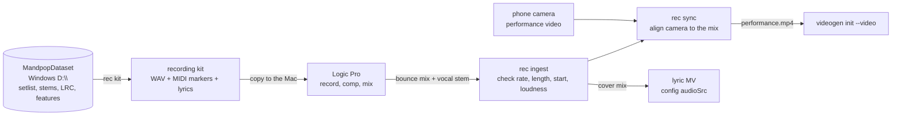

# Recording track: cover recording with Logic Pro

**Status: plan only, nothing is implemented yet.** Written 2026-11-01 on the Windows desktop, to be picked up
on the Mac laptop. Start with [Start here on the Mac](#start-here-on-the-mac).

The studio has two halves:

1. **Visuals** (built): the lyric MV (Vite, React and Remotion) and the anime MV (`tools/videogen`).
2. **Recording** (this plan): sing the cover over the dataset's backing track in Logic Pro, then bring the mix,
   the vocal stem and the performance video back into the repo so both visual pipelines use the real cover.

Logic does the recording, comping and mixing by hand. The repo automates the two file boundaries around it:
what goes into the session, and what comes back out.



## What already exists

**In the dataset** (`MandpopDataPipeline`, Layer 2 "setlist"):

- `setlist.jsonl`: the songs the owner performs, with `key_offset` (signed semitones), `gender_variant`,
  `favorite`, and paths to `instrumental`, `lyrics` and `guide_vocal`.
- Per song under `songs/<title>/`:
  - `instrumental.wav` and `vocals.wav` (Demucs `htdemucs_ft` stems, 44.1 kHz, 16-bit stereo), plus `.m4a` copies.
  - `lyrics.lrc`, already through the alignment gate.
  - `features.json`: `bpm`, `key`, `mode`, `loudness_lufs`, `duration_sec` and detected `sections`.
- The dataset does **not** produce transposed audio. Today `key_offset` is only applied at playback time by the
  karaoke app.

**In this repo:**

- `tools/videogen/videogen/lyrics.py` parses LRC, ASS and SRT.
- `tools/videogen/videogen/media.py` finds ffmpeg and probes durations.
- `videogen init --video` already takes a performance recording, and its audio becomes the MV soundtrack.
- Missing: nothing turns a setlist song into a session, and nothing brings the takes back.

## Machines

| Machine | Role in this track |
|---|---|
| Mac laptop | Logic Pro recording and mixing. Also runs `rec ingest` and `rec sync`, the videogen CPU stages and Remotion. |
| Windows desktop | Holds the dataset (`D:\MandpopDataset`), so `rec kit` runs here and the kit is copied to the Mac. |
| Remote GPU (rcs) | videogen GPU stages, unchanged. |

## Phases

### R0: Mac bring-up (manual)

1. Install the toolchain:
   - `brew install python@3.12 node ffmpeg rubberband`
   - `bash tools/videogen/scripts/setup.sh --cpu`, then `npm install`.
2. Run the checks: `npm run typecheck` and `npm run videogen:test`. **Neither has been run on macOS yet**, so record
   what breaks and fix it in a commit.
3. Audio setup:
   - Note the audio interface, the microphone and the Logic version.
   - Settle on 48 kHz / 24-bit for the session, because video is 48 kHz.
   - Use an I/O buffer of 64 or 128 samples while recording.
4. Measure the round-trip latency once with Logic's recording delay test and note it here. A wrong value shifts
   every take.

**Done when:** both suites pass on the Mac, and one test take of a few seconds plays back in time.

### R1: recording kit (`rec kit <title>`)

Runs where the dataset is. It reads the song's `setlist.jsonl` row and writes `data/recording/<song-id>/kit/`:

| File | What it is |
|---|---|
| `instrumental.wav` | Backing track at 48 kHz / 24-bit, transposed by `key_offset` with rubberband when that is not 0. |
| `guide_vocal.wav` | Original vocal, treated the same way. Monitoring only, never part of the mix. |
| `markers.mid` | Standard MIDI file with the detected tempo, one marker per section and one per lyric line. Logic loads it with File ▸ Import ▸ MIDI File, into the global Tempo and Marker tracks. |
| `lyrics.lrc`, `lyrics.txt` | Timed lyrics to read while singing. `lyrics.txt` is a printable sheet with section headings. |
| `kit.json` | The contract: version, title, artist, song-id, key, `key_offset`, bpm, duration, sample rate, and source file hashes. |

Rules:

- Every file starts at song time 0, so placing them at the project start in Logic needs no offsets.
- Markers are placed by seconds, converted to MIDI ticks through the tempo written into the same file. They land
  at the right moment even when the detected bpm is off; a wrong bpm only makes the bar grid look wrong.
- With a `key_offset`, the LRC times stay the same (rubberband changes pitch, not length), and the kit's key is
  the transposed one.

Tests (fixtures, no dataset needed):

- The `setlist.jsonl` lookup: exact match, substring match, several matches and no match.
- The marker MIDI writer: parse it back and check marker names and times to ±1 ms.
- The `kit.json` schema.
- The rubberband and ffmpeg argument lists.
- A refused overwrite.

**Done when:** a kit for one setlist song opens in Logic with the markers on the lyric lines.

### R2: Logic session template (manual on the Mac, documented in the repo)

Logic has no scripting API for sessions; Scripter only handles MIDI. So the template is made by hand once and
documented in `tools/recording/logic/README.md` with screenshots.

- **Tracks:**
  1. Instrumental (locked).
  2. Guide vocal (muted in the mix, sent to the headphone cue only).
  3. Lead vocal (take folder, comp with Quick Swipe).
  4. Double.
  5. Harmony.
- **Buses:**
  - A vocal bus: EQ, compressor, de-esser.
  - Reverb and delay sends.
  - Master: a limiter and the Loudness Meter. Target −14 LUFS integrated and −1 dBTP for YouTube.
- **Save it as** a Logic project template named `Reprise Cover`.
- **Storing it in the repo:** if the `.logicx` package stays small (no audio inside), commit a zip of it. Otherwise
  commit only the documented settings and channel-strip patches.
- The kit is plain WAV + MIDI, so the same kit works in GarageBand, Reaper or any other DAW.

### R3: performance video

videogen's perform shots copy the singer's pose and mouth from a video, so record one while singing:

- Use a phone on a tripod, landscape, at eye level.
- Keep the face and mouth clearly visible, with soft frontal light.
- Avoid a busy background and on-screen text.
- Keep the camera's own audio. `rec sync` uses it as the scratch track.
- Clap once in front of the camera before the song as a fallback sync point.
- One full take on camera is enough, even if the audio is comped from several takes. A lip-sync step can fix the
  mismatch later (videogen next steps).

### R4: bounce and bring back (`rec ingest`, `rec sync`)

**Bounce convention in Logic:** bounce from the project start, 48 kHz / 24-bit WAV, into
`data/recording/<song-id>/takes/<YYYY-MM-DD>/`:

- `mix.wav`: the full cover.
- `vocal.wav`: the processed lead vocal alone, kept for lip sync and pitch reports.
- Optional extra stems.

**`rec ingest <song-id>`** checks the bounce against the kit and reports problems with the fix:

- Sample rate and bit depth.
- Length within ±0.1 s of the kit.
- Start alignment: cross-correlate the mix against the kit instrumental. A bounce that started late shows up as an
  offset.
- Integrated loudness and true peak, measured with ffmpeg `ebur128`.
- Then it writes `cover.m4a` (AAC) for the lyric MV and YouTube.

**`rec sync <song-id> --video take.mov`** aligns the camera to the mix:

- It finds the offset by cross-correlating the onset envelopes of the camera audio and `mix.wav`. The clap is the
  fallback when correlation is weak.
- It writes `performance.mp4`: the camera picture, trimmed to song time 0, with the mix as its only audio.
- The next step is `videogen init --title <title> --video performance.mp4`. The lyric MV gets `cover.m4a` as its
  `audioSrc`.

Tests (synthetic signals, no Logic needed):

- A known offset is recovered to within one video frame.
- A shifted or short bounce is reported.
- The loudness report is parsed from captured ffmpeg output.
- The trim and mux argument lists.

**Done when:** one song goes from kit to Logic to `performance.mp4`, and `videogen doctor` accepts the project.

### R5: later

- **Pitch and timing report:** compare `vocal.wav` with the guide vocal (pYIN pitch contour, onset times) and
  report flat, sharp or late lines per lyric line, as a practice aid.
- **Lyric timing of the cover:** phrasing may drift from the original. Checking `vocal.wav` against the LRC is
  alignment work, so it belongs in the dataset (its `audit --layer2` tooling).
- **Audio-driven lip sync** for videogen, using `vocal.wav`.
- **Remotion render on the Mac** for the lyric MV with the cover audio.

## Data layout and git

```
data/recording/<song-id>/
  kit/                 # from `rec kit`; regenerate any time
  takes/<date>/        # Logic bounces
  video/               # camera originals
  performance.mp4      # from `rec sync`
```

- All of `data/recording/*/` is git-ignored except a future `notes.md`.
- Logic projects stay in `~/Music/Logic/`, outside the repo. They are large and only matter on the Mac.
- The code goes in `tools/recording/` as a Python package with a `rec` CLI and its own tests. It reuses
  `videogen.lyrics` and `videogen.media` rather than copying them.
- New tools go in `docs/toolchain.md` in the same commit that starts using them: rubberband, mido if the MIDI
  writer is not hand-rolled, and numpy.

## Decisions for the owner

These need an answer before R1 starts. The first option in each is the recommendation.

1. **Scope of the repo.**
   - `CLAUDE.md` and the README define this repo as visuals only, and put "audio processing" in the dataset.
   - Recommendation: the repo also owns the recording session tooling (kit, ingest, sync). The dataset keeps
     separation, alignment and features.
   - Update both documents when this is accepted.
2. **Where transposition happens.**
   - (a) In `rec kit`, offline with rubberband. `key_offset` is a performance preset and the transposed track is a
     session file, not labeled data.
   - (b) In the dataset, as a new transposed-stem output.
   - (c) In Logic, with Flex Pitch or a pitch-shift plug-in. This is the lowest quality.
3. **How the kit reaches the Mac.**
   - (a) Build on Windows and copy it through a synced folder. A kit is about 100 MB per song.
   - (b) Mount `D:\MandpopDataset` over SMB and build on the Mac.
   - (c) Clone the dataset on the Mac.
4. **Session format.**
   - 48 kHz / 24-bit (matches video), or keep the dataset's 44.1 kHz and resample only at `rec sync`.
5. **Tool name and place.**
   - `tools/recording` with a `rec` CLI, or subcommands of an existing tool.

## Start here on the Mac

1. `git pull`, then read this file and the decisions above.
2. Do R0 and write down here what happened: the audio interface, the latency, and test results on macOS.
3. Ask the owner the five decisions. Record the answers in this file and update `CLAUDE.md` for decision 1.
4. Implement R1 with fixture tests. A real kit needs the dataset (decision 3). Until then, copy one song folder
   and its `setlist.jsonl` row for a dry run.
5. Build the R2 template in Logic, then record one song through R3 and R4.

Follow the repo rules for every step:

- Tests ship with each feature, and the README and toolchain doc are updated in the same commit.
- The full suite passes before each commit.
- Each round is a short branch merged back to main.
