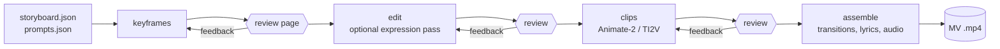

# videogen

Turns a cover-song performance video and a lyrics storyboard into an anime MV. It is a semi-automatic loop:
every stage generates candidates, writes a review page, and regenerates only the shots you reject.



| Shot kind | Still image | Motion |
|---|---|---|
| `perform` | Qwen-Image-2.1 redraws a frame of the source video as the character | Wan-Animate-2 (distilled): the source video drives the motion |
| `story` | Qwen-Image-2.1 with the character sheet as reference | Wan2.2-TI2V-5B image-to-video |
| `image` | Qwen-Image-2.1, no people or only "her" from behind | Wan2.2-TI2V-5B |

Nothing is tied to one machine. Each model is placed according to the GPU memory free at the time, and any
GPU stage can run on another host (see [Hosts](#hosts)).

## Quick start

```bash
bash tools/videogen/scripts/setup.sh          # Linux/macOS (GPU stack, CUDA 12.8 torch)
# Windows: powershell -ExecutionPolicy Bypass -File tools/videogen/scripts/setup.ps1
# A machine that only reviews and assembles:  setup.sh --cpu  /  setup.ps1 -Cpu
```

Setup ends by running the test suite (`67 passed`). Then check a project:

```bash
videogen --project data/videogen/alaska doctor
```

```
  ✓ project files
  ✓ ffmpeg: ffmpeg
  ✓ torch ...
  device: cuda NVIDIA H100 80GB HBM3 free 38.2 / 79.2 GB
    image    model_offload
    edit     group_offload
    i2v      gpu
    animate  group_offload, reference K/V on CPU
  hosts: local (local), h100 (rcs)
```

## Workflow: from song to upload

These are the phases of the whole job. Phases 1 and 2 are still done by hand with Claude; `videogen` runs
phases 3 to 8. Each ◆ marks a point where the owner decides.

| # | Phase | Who / what | Output | Owner checkpoint |
|---|---|---|---|---|
| 1 | **Storyboard from the lyrics.** Split the song into 3–10 s shots that follow the lyric lines. Give each one a kind (`perform` / `story` / `image`), a light key (night, amber, dawn, gold, rose, lamp) and a transition. About half the time should be imagery and story, not the singer. | Claude + owner | `storyboard.json`, `prompts.json` | ◆ storyboard page |
| 2 | **Character design.** Draw several outfits and face variants from stills of the performance, then pick one. It does not need to look like the singer; it needs to stay the same character in every shot. | Qwen-Image-Edit-2509 | `assets/character.png` | ◆ pick one |
| 3 | **Keyframes.** Two candidates per shot. A perform shot redraws a source frame as the character; story and image shots are drawn from prompts. | `videogen keyframes` | `work/keys/` | ◆ `review keyframes` |
| 4 | **Expression pass (optional).** Adjusts the mood of shots where the face is visible. | `videogen edit` | `work/keys/*_edit*.png` | ◆ `review edit` |
| 5 | **Animation.** Perform shots copy the singer's motion; story and image shots animate their keyframe. | `videogen clips` | `work/clips/` | ◆ `review clips` |
| 6 | **Assembly.** Fit each clip to its slot, apply the transitions, burn in Traditional Chinese lyrics, mux the original audio. | `videogen assemble` | `work/<name>.mp4` | ◆ watch it |
| 7 | **Cover.** Key art, then a typeset title. | `videogen cover`, `cover-title` | `work/cover/cover_s*.jpg` | ◆ pick one |
| 8 | **Iterate.** Reject any shot at any stage. Only that shot and what depends on it is regenerated, then assemble again. | `videogen feedback` | | |

Rules that came out of the first MV (阿拉斯加海灣), already written into its prompts:

- Perform crops are 16:9 and sit above the burned-in karaoke subtitles of the source, so no subtitle
  inpainting is needed.
- "Her" never shows her face: always from behind, far away, or only her hair.
- Indoor shots drop the coat and keep the knit sweater.
- Motion prompts stay small and static ("static camera, only his eyes move"). Big verbs make the I2V model
  invent actions, such as standing up and walking out of frame.
- Melancholy reads deeper without tears. The edit prompt and every negative prompt exclude tears and crying.
- The expression edit must keep exactly what the hands hold. Otherwise it may add a microphone to a story shot.

## Make an MV

Run each stage from the repo root with `--project data/videogen/<song>`. Add `--host <name>` to run the GPU
stages (`keyframes`, `edit`, `clips`) somewhere else.

1. **Keyframes.** `videogen keyframes` draws two candidates (`seeds`) for every shot that has none yet.
2. **Review.** `videogen review keyframes` writes `work/review/keyframes.html`. Pick an image per shot,
   tick “重做” with a note to reject a shot, then press “複製回饋”.
3. **Feedback.** Paste the copied text into `videogen feedback` (stdin, or `--file`). It prints what
   changed, for example `S16: redo keyframes (only the two of them from behind)`.
4. **Repeat.** `videogen keyframes` redraws only the rejected shots, using fresh seeds and your note.
5. **Expression pass (optional).** `videogen edit` applies `prompts.expression_edit` to the picked images
   of `face_shots`. Review it with `videogen review edit`; choosing “原圖” keeps the original.
6. **Animate.** `videogen clips` animates every approved shot. Then run `videogen review clips` and send feedback.
7. **Assemble.** `videogen assemble` writes `work/<name>.mp4` at 1280×720, 24 fps, with the transitions,
   the burned-in lyrics and the original audio.

8. **Cover.** `videogen cover` draws cover art candidates from `prompts.cover`, using the character
   reference when the prompt mentions `{HE}`. Leave the title side empty in the prompt. Then
   `videogen cover-title` sets `cover.title` and `cover.subtitle` (project.json) on each candidate in a real
   font and writes `work/cover/cover_s<seed>.jpg` at 1280×720. Titles are typeset rather than generated, so
   Chinese strokes are always right. The font is looked up in the usual font folders on Windows, macOS and
   Linux, or `cover.font` can name a file.

`videogen status` shows where every shot stands:

```
shot  kind     cand  pick             edit  clip             pending
S04   perform     2  S04_s1.png       yes   S04_v0.mp4
S16   story       4  S16_s3.png       -     -                keyframes: only the two of them from behind
```

### Feedback format

The review pages produce this format. You can also type it by hand:

```
videogen-feedback stage=keyframes
pick S01=s1 S02=s2
redo S16: only the two of them from behind, far away
note S05: keep, slightly warmer
edit-off S04            # edit stage: keep the unedited image
```

Picking a different image clears that shot's edit and clip. Asking for a keyframe redo clears its edit and
clip too. Later stages pick the change up on their next run.

## Commands

| Command | Options | What it does |
|---|---|---|
| `doctor` | | Checks project files, ffmpeg and Python packages, and prints the device and memory plan for each model |
| `show-config` | | Prints the effective config after all layers are merged |
| `status` | | Lists candidates, pick, edit, clip and pending redo for every shot |
| `keyframes` | `--only S01 S05`, `--seeds 1 2` | Generates still candidates for pending shots (or the listed ones) |
| `edit` | `--only` | Runs the expression pass on picked images of `face_shots` |
| `clips` | `--only`, `--kinds perform story image` | Animates approved images |
| `assemble` | `--out FILE` | Cuts the final MV |
| `review` | `keyframes \| edit \| clips`, `--only` | Writes a self-contained review page to `work/review/<stage>.html` |
| `feedback` | `--file F` (default: stdin) | Applies picks, redos, notes and `edit-off` |
| `cover` | `--seeds 1 2 3 4` | Generates cover art candidates (GPU, works with `--host`) |
| `cover-title` | | Typesets the title and subtitle on every cover candidate (CPU) |
| `attach` | with `--host` | Re-attaches to the last job sent to that host (after a closed terminal or dropped connection), streams its log, and syncs the results |

Global options: `--project DIR` (default: the current directory), `--host NAME` (default: `$VIDEOGEN_HOST`,
otherwise `local`).

## Project layout

```
data/videogen/<song>/
  project.json      paths, crops, face_shots, hosts       (committed)
  storyboard.json   shots: timing, kind, light, transition (committed)
  prompts.json      every word the models see              (committed)
  assets/           source video, character.png, lyrics.ass (git-ignored)
  work/             state.json, keys/, clips/, review/, final mp4 (git-ignored)
```

A new song needs only new data: a storyboard, prompts and assets. No code changes.

**project.json**

| Key | Meaning |
|---|---|
| `name`, `title` | Output file name and page title |
| `source_video`, `audio` | Performance video (drives perform shots) and the audio muxed into the MV |
| `character` | Character reference image (the approved character sheet) |
| `lyrics_ass` | Lyrics subtitles. They are rescaled to the output size and restyled with `lyrics_style` |
| `crops` | `{framing: [x0, y0, x1, y1]}` source-video crops as fractions, 16:9, kept above any burned-in subtitles |
| `cover` | `{title, subtitle, side, font, size, seeds}`. `title` defaults to the project title. `side` is `left` or `right` |
| `face_shots` | Shot ids where the protagonist's face is visible (the scope of `edit`) |
| `hosts` | Execution hosts (below) |
| any default | Overrides a built-in default, e.g. `"animate_size": [832, 464]` or `"models": {"i2v": "..."}` |

Built-in defaults are in `videogen/config.py` (`DEFAULTS`). Settings are layered as
defaults < project.json < host profile < environment < CLI.

| Environment variable | Effect |
|---|---|
| `VIDEOGEN_HOST` | Default `--host` |
| `VIDEOGEN_WORKDIR` | Work directory |
| `VIDEOGEN_ANIMATE_SIZE` | Performance-shot render size, e.g. `832x464` |
| `VIDEOGEN_SEEDS` | Keyframe seeds, e.g. `1,2,3` |
| `VIDEOGEN_FFMPEG` | ffmpeg binary. Otherwise ffmpeg on PATH is used, then imageio-ffmpeg's bundled binary |
| `HF_HOME`, `HF_HUB_OFFLINE`, `HF_HUB_DISABLE_XET` | Model cache location and download behavior (Hugging Face) |

**prompts.json** fields (see `videogen/prompts.py`):

- `style` and the `negative_*` texts.
- `vars`: placeholders such as `{HE}` and `{COAT}`. A shot whose keyframe mentions `{HE}` gets the character
  image as a reference.
- `framing`, `perform_ref`, `perform_motion`.
- `expression_edit` and `face_mood`.
- `shots.<id>.keyframe` and `shots.<id>.motion`.

## Hosts

`hosts` in project.json names the machines a GPU stage can run on:

```json
"hosts": {
  "local": {"kind": "local"},
  "h100": {
    "kind": "rcs",
    "python": "/tmp/v2v/venv/bin/python",
    "workdir": "/tmp/v2v/runs/mv",
    "paths": {"source_video": "/tmp/v2v/inputs/alaska_clip.mp4"},
    "env": {"HF_HOME": "/tmp/v2v/hf", "HF_HUB_DISABLE_XET": "1"}
  }
}
```

`videogen --host h100 clips` works in four steps:

1. It bundles the package, the project files, the small assets and `work/state.json`.
2. It submits the bundle as a job and streams the job log.
3. On the host, the same command runs inside `_host-wrap`.
4. It copies every file the stage wrote, plus the updated state, back into the local `work/`.

The host keeps its own `workdir`, so images from earlier stages are already there. If the stage fails or is
cancelled, the command exits non-zero, and the shots that did finish are still copied back. A host profile's `paths`
can replace large assets with copies already on that machine.

Supported kinds:
- `local`: runs in this process. A machine with a GPU only needs the `local` host.
- `rcs`: remote-console jobs. The binary comes from the profile's `rcs`, `$RCS_EXE`, `PATH`, or
  `%LOCALAPPDATA%\remote-console\bin\rcs.exe`.

To add another backend (ssh, slurm, a cloud API), write a class with
`submit(bundle_dir, files, name, command) -> results_dir` and register it in `remote.BACKENDS`.

## Technical route (as of 2026-10)

### Chosen models

| Role | Model | Why this one | License note |
|---|---|---|---|
| `image`: keyframes, perform references, cover | Qwen-Image-2.1 | Takes up to about 10 reference images, so one character sheet keeps the face consistent. Strong at anime styles; no CFG needed | qwen-research license: check it before monetized use |
| `edit`: expression pass | Qwen-Image-Edit-2509 | Changes only what is asked and keeps line art and colors clean | Apache-2.0 |
| `animate`: perform shots | Wan2.2-Animate-2-14B (distilled, 10 steps) | Takes the motion from the real performance and the look from the reference image. Identity holds across segments | Apache-2.0 |
| `i2v`: story and image shots | Wan2.2-TI2V-5B | Good quality at 720p in about 1.5–2.5 min per shot, and fits easily next to other jobs | Apache-2.0 |

All four are flow-matching models. The `flow_shift`, `steps` and guidance settings belong to that family.

### Measured on an H100 80 GB

| Step | Setting | Time |
|---|---|---|
| Keyframe (Qwen-Image-2.1, 40 steps, 1280×704) | GPU shared, 38 GB free → model offload | about 30 s |
| | GPU free | about 11 s |
| Expression edit (Edit-2509, 40 steps) | shared, block streaming | about 2.5 min |
| Perform clip (Animate-2, 944×519, 2 segments of 81 frames) | GPU free, K/V cache on CPU | 3–6 min per shot |
| Story or image clip (TI2V-5B, 1280×704, ≤ 145 frames) | GPU free | 1.5–2.7 min per shot |
| Assembly (43 shots, 3:43, libx264 slow) | laptop CPU | about 4.5 min |

The whole 3:43 MV took about 4 GPU-hours (part of it on a shared card), not counting review time.

### Tried and dropped

| Approach | What went wrong | Replaced by |
|---|---|---|
| Wan2.1-VACE-1.3B, depth-controlled V2V over the whole video in chained 81-frame chunks | Identity drifted, the image darkened over time, and seams popped (exposure bias: each chunk conditions on the previous chunk's errors) | Shot-by-shot generation that always starts again from the character reference |
| A per-frame style filter on the performance | Followed the video but told no story | A lyric-driven storyboard with story and image shots |
| Qwen-Image-2.1 as the editor | Edits came out grainy and over-sharpened | Qwen-Image-Edit-2509 for `edit` |
| Animate-2 with everything on GPU on a shared card | Out of memory: the reference K/V cache alone is about 34 GB, and uncompiled flex attention asked for 535 GB | Memory plan: compiled flex attention plus the K/V cache in pinned CPU memory |

### Known limits

- **Lip sync** follows the singer's face in the source video, not the audio, so it is close but not exact
  on every syllable.
- **Perform shots** render at 944×519 and are upscaled to 720p, so they are slightly softer than story shots.
- **Prompt drift** can still happen: a story keyframe may show the character twice or add props. The
  review pages exist to catch this.
- **Phases 1–2** (storyboard and character design) are not yet commands.

### Next steps, in rough order of value

1. **Character LoRA** trained on 20–40 approved images, for a tighter identity than reference images alone.
2. **`videogen storyboard`** to draft `storyboard.json` and `prompts.json` from timed lyrics (the
   MandpopDataset LRC), and **`videogen character`** for character sheets.
3. **Audio-driven lip sync** for close-ups (InfiniteTalk or Wan2.2-S2V) instead of motion transfer.
4. **First-and-last-frame I2V** (Wan2.2-I2V-A14B) for shots that must land on a specific end frame, plus
   matched cuts between shots.
5. **An anime-tuned upscaler** for perform clips. Distilled models for drafts and full steps for finals.
6. **One-to-few-step samplers** such as rCM or MeanFlow-family distillations, once open checkpoints exist for
   these models. Watch only for now.
7. **Remotion handoff**, so the generated clips can be combined with this repo's lyric layer and scenes.

## Memory planning

`hardware.plan(model, device)` chooses one of three placements:

| Placement | When | Cost |
|---|---|---|
| `gpu` | The whole pipeline plus about 8 GB headroom fits | Fastest |
| `model_offload` | Only the largest component fits, so components swap in and out | Small |
| `group_offload` | Even that does not fit, so transformer blocks stream from CPU | Slow; runs in about 10 GB |

For Wan-Animate-2 the planner also estimates the per-layer reference K/V cache (about 34 GB at 960×528) and
moves it to pinned CPU memory when it does not fit. `models.py` always applies one diffusers 0.41
workaround: Wan-Animate-2's flex attention is compiled. Uncompiled, it falls back to dense attention that
needs hundreds of GB.

## Architecture

| Module | Role |
|---|---|
| `config.py` | Layered config and host profiles |
| `storyboard.py` | Schema validation and frame math (gap-free spans, Wan `4k+1` frame counts) |
| `prompts.py` | Builds every prompt from prompts.json |
| `state.py` | `work/state.json`: candidates, picks, edits, clips, redo requests and their invalidation |
| `feedback.py` | Parses and applies review feedback |
| `review.py` | Review pages (images inlined, works offline or as a shared page) |
| `hardware.py` | Device probe and memory planning |
| `models.py` | The four model roles (`image`, `edit`, `animate`, `i2v`), each behind a small `generate()` interface |
| `stages.py` | `keyframes`, `edit`, `clips`, `assemble` |
| `remote.py` | Host bundling, job submission and result sync |
| `media.py` | ffmpeg I/O and frame math |

Swapping a model for one with the same interface is a one-line change to `models.<role>` in project.json. A new
architecture needs a new class in `models.py`.

## Tests

```bash
python -m pytest -q tools/videogen/tests     # or: npm run videogen:test
```

The tests cover config layering, storyboard validation and frame math, prompt building, state invalidation,
feedback parsing (including the first review page's format), memory planning, media math, lyric restyling
and review-page output. GPU stages are verified by running them. The Alaska pilot covered all three
generators on a shared H100 with 38 GB free.

## Troubleshooting

| Symptom | Fix |
|---|---|
| `CUDA out of memory` in Wan-Animate-2 at `rope_apply` or `math_attention` | Update to this version, which compiles flex attention and plans the K/V cache. Or lower `animate_size` |
| `Error while opening encoder` from libx264 | Odd frame size. `media.write_video` now trims to even dimensions |
| Hugging Face download stalls mid-file | `HF_HUB_DISABLE_XET=1`, then rerun. Finished files are kept |
| PyPI's torch rejects the CUDA driver | Rerun setup with `TORCH_INDEX_URL` set to the matching `cu12x` index |
| Qwen-Image-2.1 expression edits look grainy or oversharpened | The `edit` role uses Qwen-Image-Edit-2509, which keeps the original rendering |
| Lyrics are missing from the MV | ffmpeg needs libass (`ffmpeg -filters` lists `ass`). Set `VIDEOGEN_FFMPEG` to a full build |
| Story clip drifts (he stands up, walks off) | Keep motion prompts small and static ("static camera, only his eyes move"). The I2V negative already lists those actions |
